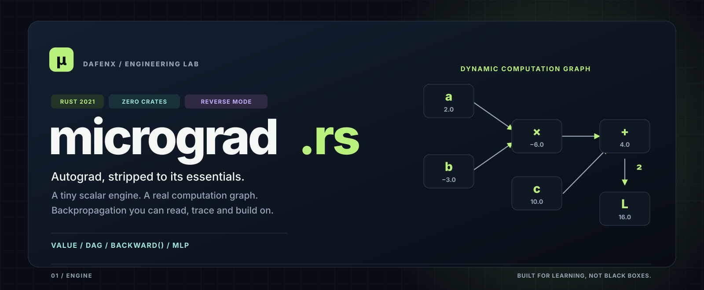
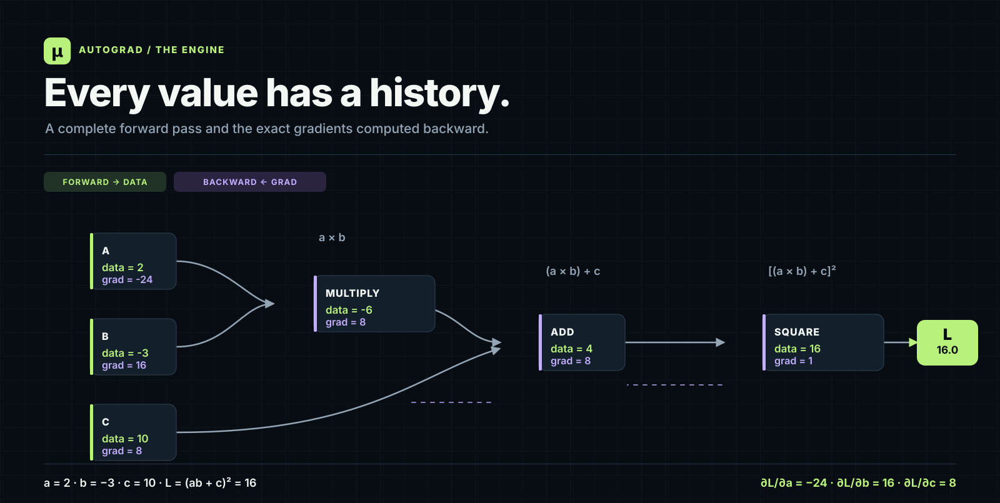
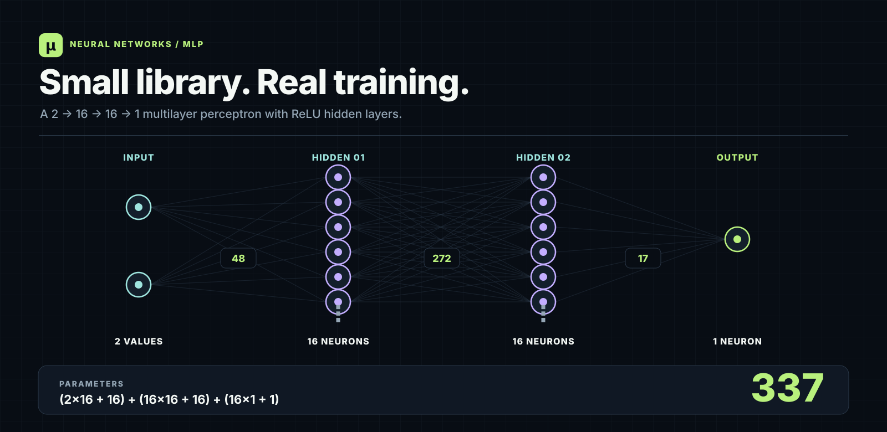
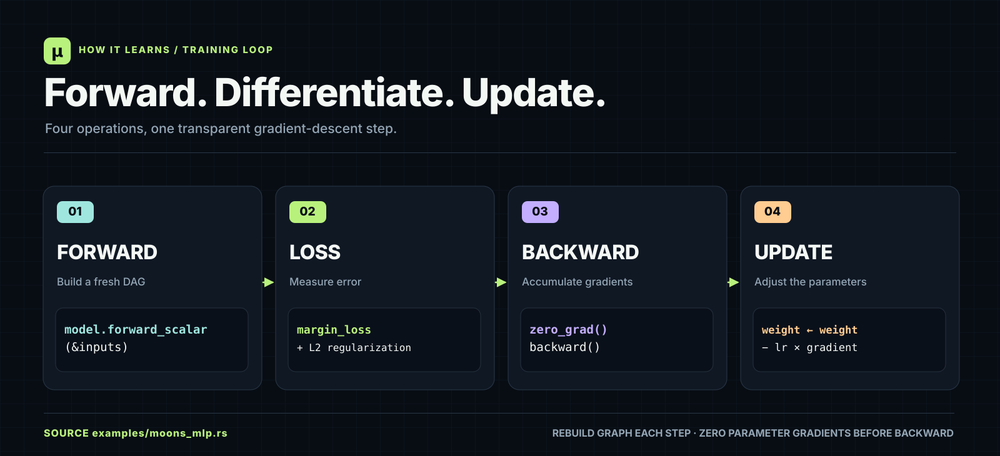

<p align="center">
  
</p>

<p align="center">
  <a href="https://github.com/Dafenxz0/micrograd-rs/actions/workflows/ci.yml"></a>
  
  
  <a href="LICENSE"></a>
</p>

<p align="center">
  <strong>Build the graph. Follow the gradient. Understand backpropagation.</strong><br />
  A small, dependency-free, scalar automatic differentiation engine and neural-network playground written in Rust.
</p>

---

## What is micrograd-rs?

`micrograd-rs` is a Rust implementation inspired by [Andrej Karpathy's micrograd](https://github.com/karpathy/micrograd). It builds a **dynamic directed acyclic graph (DAG)** as you perform arithmetic on scalar `Value`s, then traverses that graph in reverse to compute derivatives with the chain rule.

It is intentionally **small and educational**: `f64` scalars, an explicit operation enum, a minimal fully connected neural-network API, and no third-party Rust crates. It is not intended as a GPU or production deep-learning framework.

**What is included:**

| Area | Implementation |
| :--- | :--- |
| **Autograd** | `Value`, scalar arithmetic, `powf`, ReLU, reverse-mode `backward()` |
| **Computation graph** | Dynamic DAG with shared-node handling and Graphviz DOT export |
| **Neural networks** | `Module`, `Neuron`, `Layer`, `MLP` with trainable `Value` parameters |
| **Randomness** | Deterministic SplitMix64 and Box–Muller sampling, without external crates |
| **Examples** | A 2D neuron trace and a two-moons MLP training demo |
| **Checks** | Rust tests, formatting, Clippy, and example runs in CI |

## 60-second quick start

Requires a Rust toolchain with Cargo. Clone the repository and run:

```bash
git clone https://github.com/Dafenxz0/micrograd-rs.git
cd micrograd-rs
cargo test
cargo run --example moons_mlp
```

The last command trains a small MLP on a synthetic two-moons classification problem and prints loss/accuracy updates followed by an ASCII decision boundary. The demo uses a fixed seed, but the exact printed numbers should be taken from the actual run, not assumed from this documentation.

### Differentiate an expression

```rust
use micrograd_rs::Value;

fn main() {
    let a = Value::new(2.0);
    let b = Value::new(-3.0);
    let c = Value::new(10.0);

    // L = (a*b + c)^2 = 16
    let loss = ((&a * &b) + &c).powf(2.0);
    loss.backward();

    println!("loss: {}", loss.data()); // 16
    println!("dL/da: {}", a.grad());   // -24
    println!("dL/db: {}", b.grad());   // 16
    println!("dL/dc: {}", c.grad());   // 8
}
```

The gradient follows directly from the chain rule: if `u = ab + c`, then `L = u²`, so `∂L/∂a = 2ub`, `∂L/∂b = 2ua`, and `∂L/∂c = 2u`.

## Inside the autograd engine

<p align="center">
  
</p>

A `Value` stores its numeric data, gradient, and the operation that created it. Each arithmetic expression produces a new node, with links to its inputs. `backward()` topologically orders the reachable nodes and applies local derivative rules in reverse order.

The engine uses an explicit `Op` enum (`Leaf`, `Add`, `Mul`, `Pow`, `Relu`) and `Rc<RefCell<...>>` for shared, mutable scalar nodes. Subtraction, division, and negation are expressed through the core operations.

**Important detail:** this is a single-threaded, scalar-focused design. `Rc<RefCell<_>>` does not make `Value` safe to share across threads, and storing a DAG is different from performing vectorized tensor computation.

## From scalars to a neural network

<p align="center">
  
</p>

The example MLP has **two hidden layers plus one output layer**:

| Layer | Shape | Activation | Parameters |
| :--- | :--- | :--- | ---: |
| Hidden 1 | `2 → 16` | ReLU | 48 |
| Hidden 2 | `16 → 16` | ReLU | 272 |
| Output | `16 → 1` | Linear | 17 |
| **Total** | **`2 → 16 → 16 → 1`** | | **337** |

The illustration shows a representative subset of the hidden neurons for legibility. Each hidden layer actually contains 16 neurons.

Instantiate and use the network with the public API:

```rust
use micrograd_rs::{MLP, Rng, Value, Module};

let mut rng = Rng::new(1337);
let model = MLP::new(2, &[16, 16, 1], &mut rng);
let prediction = model.forward_scalar(&[Value::new(0.2), Value::new(-0.4)]);

assert_eq!(model.parameters().len(), 337);
println!("prediction: {}", prediction.data());
```

## How the training example works

<p align="center">
  
</p>

The [two-moons example](examples/moons_mlp.rs) generates 100 noisy samples, initializes a `2 → 16 → 16 → 1` MLP, and runs 100 optimization steps with hinge-style margin loss, L2 regularization, and a decaying learning rate. It then renders an ASCII classification boundary in the terminal.

```bash
cargo run --example moons_mlp
```

For each training step, the example builds a **new** forward computation graph, calls `model.zero_grad()` before `backward()`, and adjusts the trainable scalar parameters. The model has 337 learnable scalars; classification accuracy is a training-set metric, not an out-of-sample benchmark.

## Visualize a real graph with Graphviz

The library can serialize a backward graph to [Graphviz DOT](https://graphviz.org/doc/info/lang.html). To generate an SVG from the included neuron example, install the optional Graphviz `dot` command and run:

```bash
cargo run --quiet --example trace_neuron > neuron.dot
dot -Tsvg neuron.dot -o neuron.svg
```

Open `neuron.svg` in a browser. The rendered DOT graph includes numeric forward values, gradients, and operation nodes. The large diagram above is an **explanatory visualization**, not a screenshot or export of that exact `trace_neuron` run.

## Public API at a glance

| Type or method | Purpose |
| :--- | :--- |
| `Value::new(f64)` | Create a leaf scalar |
| `Value::data()`, `Value::grad()` | Inspect the scalar and its accumulated gradient |
| `Value::powf(exp)`, `Value::relu()` | Create differentiable operations |
| `Value::backward()` | Run reverse-mode differentiation from that value |
| `Value::to_dot()` | Export the reachable computation graph as DOT |
| `Module::parameters()` | Retrieve trainable scalar parameters |
| `Module::zero_grad()` | Reset module parameter gradients |
| `Neuron`, `Layer`, `MLP` | Compose fully connected networks |
| `Rng::new(seed)` | Create a reproducible pseudo-random generator |

### Scope and limitations

- **Scalar learning tool, not a tensor framework.** It operates on `f64` values, without SIMD/GPU kernels, autograd batching, or tensor shapes.
- **Build a new graph for each optimization step.** `backward()` does not clear all intermediate gradients automatically; reusing the exact same graph for another backward pass can accumulate stale intermediate gradients.
- **Mutate leaf parameters, not previously computed intermediate nodes.** `set_data()` is intended for optimizer updates; changing an input does not automatically recompute existing downstream nodes.
- **Floating-point domains still apply.** Certain power operations on zero or negative bases can produce non-finite values or derivatives. This simple educational engine does not add numerical-domain safeguards.
- **No automatic multithreading.** The graph representation uses `Rc<RefCell<_>>`.

## Project structure

```text
micrograd-rs/
├── .github/workflows/ci.yml
├── Cargo.toml
├── src/
│   ├── engine.rs         # Values, operations, backward pass, DOT export
│   ├── nn.rs             # Neuron, Layer, MLP, Module
│   ├── rng.rs            # Dependency-free random sampling
│   └── lib.rs            # Public exports
├── examples/
│   ├── moons_mlp.rs      # Synthetic two-moons classification
│   └── trace_neuron.rs   # Graphviz DOT example
├── tests/
│   └── engine_tests.rs   # Scalar/gradient and MLP tests
└── assets/readme/        # Project graphics, added by this README kit
```

## Development

```bash
cargo fmt --all -- --check
cargo clippy --all-targets -- -D warnings
cargo test
cargo run --example moons_mlp
```

CI runs these checks along with the Graphviz trace example. If you want to extend the engine, useful next steps include additional numerical edge-case tests, iterative graph traversal for deep expressions, and gradient checks against finite differences.

## Credits & license

Inspired by and ported from the ideas behind [Andrej Karpathy's micrograd](https://github.com/karpathy/micrograd), with a Rust implementation, explicit operation representation, deterministic built-in RNG, and CLI examples. MIT licensed. See [LICENSE](LICENSE).
